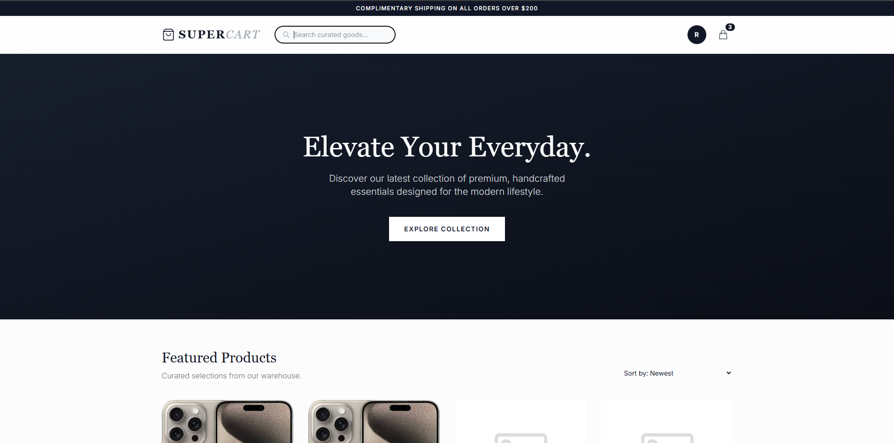
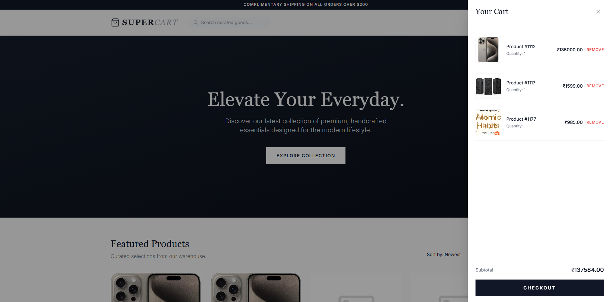
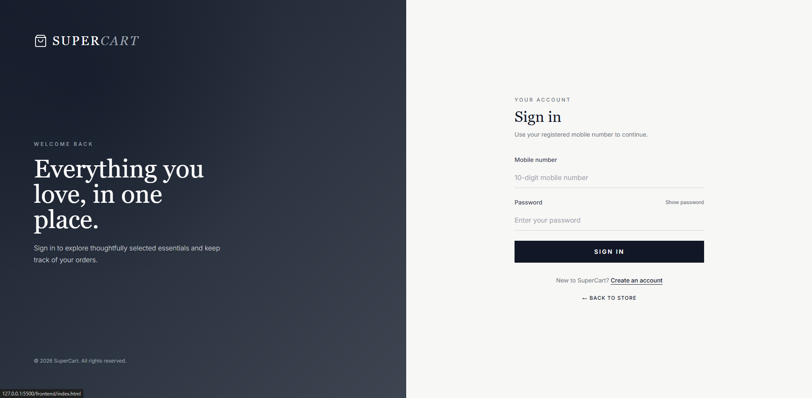
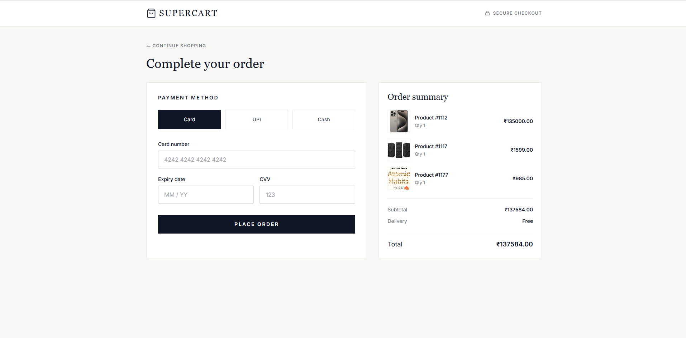
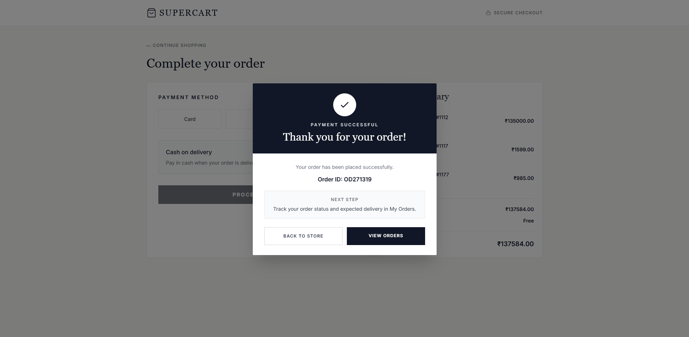
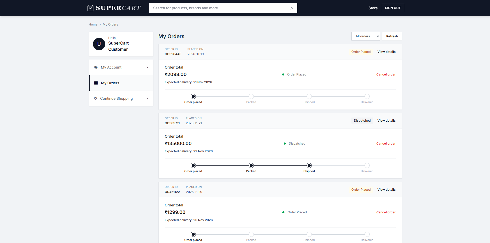
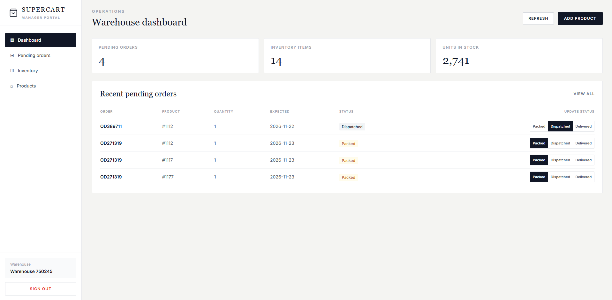
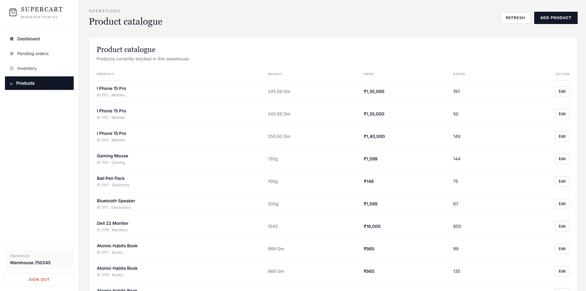

# SuperCart Logistics Management System


SuperCart is a full-stack logistics and e-commerce project built with
Python, FastAPI, MySQL, SQLAlchemy, and a lightweight HTML frontend. It
connects the complete customer shopping journey with warehouse operations:
customers can discover products, manage a cart, place and pay for orders,
while managers manage inventory and update order statuses from a dedicated
portal.

## Highlights

- Customer storefront with product browsing, search, product images, and
  responsive layouts
- Customer registration, sign-in, JWT-based authentication, and role-based
  access control
- Cart management with add, view, and remove operations
- Checkout with card, UPI, and cash-on-delivery payment options
- Automatic order creation, stock updates, delivery-time calculation, and
  order confirmation
- Customer account profile updates and order history
- Order details, status filtering, cancellation, and product imagery
- Warehouse manager dashboard with operational statistics
- Inventory viewing, stock additions, and product catalogue management
- Product creation with image URLs and product detail updates
- Pending-order review and status updates from the manager portal
- SQLAlchemy repository/service architecture with centralized exception
  handling
- Interactive FastAPI documentation at `/docs`

## Product Experience

### Customer storefront

The customer experience is implemented as a set of static pages in
[`frontend/`](<./frontend/>):

- `login.html` — customer and manager sign-in and customer registration
- `index.html` — product catalogue, search, cart, and account navigation
- `account.html` — profile details and account updates
- `payments.html` — cart review, delivery address, and payment selection
- `orders.html` — order history, filtering, details, and cancellation

### Warehouse manager portal

Managers use [`manager.html`](<./frontend/manager.html>) to:

- Review pending orders assigned to their warehouse
- View inventory quantities and product catalogue data
- Add products and initial stock
- Add stock to existing inventory
- Update product details and images
- Change order status as fulfilment progresses

## Screenshots

### Customer shopping flow

<p align="center">
  
  
</p>
<p align="center">
  
  
</p>
<p align="center">
  
  
</p>

### Warehouse operations

<p align="center">
  
  
</p>

## Architecture

The backend follows a layered architecture that keeps HTTP handling,
business rules, and persistence responsibilities separate:

```text
Browser / Frontend
        |
        v
FastAPI Routers
        |
        v
Services
        |
        v
Repositories
        |
        v
SQLAlchemy Models
        |
        v
MySQL
```

### Backend layers

- `app/routers/` — authentication, customer, product, and warehouse API
  routes
- `app/services/` — authentication, customer, order, payment, product, and
  warehouse business logic
- `app/repositories/` — database access and query operations
- `app/models/` — SQLAlchemy models for users, customers, products,
  inventory, orders, and payments
- `app/schemas/` — Pydantic request and response schemas
- `app/database/` — engine configuration and database sessions
- `app/exceptions/` — application exceptions and FastAPI exception handlers

## API Overview

All routes are served by the FastAPI application in [`main.py`](<./main.py>).
Protected routes require a bearer token returned by `/auth/signin`.

| Area | Example endpoints | Access |
| --- | --- | --- |
| Authentication | `POST /auth/signin`, `POST /auth/signup/customer`, `POST /auth/signup/manager` | Public |
| Products | `GET /products/all`, `GET /products/images` | Public |
| Customer | `GET /customer/search`, `POST /customer/cart/add`, `POST /customer/order/place` | Customer |
| Orders | `GET /customer/order/view`, `GET /customer/order/{order_id}`, `DELETE /customer/order/delete` | Customer |
| Warehouse | `GET /warehouse/product/view`, `POST /warehouse/product/add` | Manager |
| Fulfilment | `GET /warehouse/orders/pending`, `PATCH /warehouse/orders/status/update` | Manager |

After starting the backend, open
[`http://127.0.0.1:8000/docs`](http://127.0.0.1:8000/docs) for the complete
interactive API reference.

## Technology Stack

- **Backend:** Python, FastAPI, Uvicorn
- **Database:** MySQL
- **ORM and driver:** SQLAlchemy, PyMySQL
- **Validation:** Pydantic
- **Authentication:** JWT bearer tokens, bcrypt password hashing
- **Frontend:** HTML, JavaScript, Tailwind CSS via CDN
- **Location and delivery:** geopy and requests
- **Testing:** pytest

## Getting Started

### Prerequisites

- Python 3.13 or a compatible modern Python release
- MySQL Server
- Git

### 1. Clone the repository

```bash
git clone <YOUR_GITHUB_REPOSITORY_URL>
cd "Logistics Management Project"
```

### 2. Create and activate a virtual environment

Windows PowerShell:

```powershell
python -m venv venv
.\venv\Scripts\Activate.ps1
```

macOS or Linux:

```bash
python -m venv venv
source venv/bin/activate
```

### 3. Install dependencies

```bash
python -m pip install -r requirements.txt
```

### 4. Configure MySQL

Create a MySQL database, then copy `.env.example` to `.env` and set the
credentials for your local database:

```env
DB_HOST=localhost
DB_PORT=3306
DB_USER=your_username
DB_PASSWORD=your_password
DB_NAME=your_database
```

Keep `.env` private. It is ignored by Git and must not be committed.

### 5. Start the API

```bash
uvicorn main:app --reload
```

The API is now available at `http://127.0.0.1:8000`.

### 6. Start the frontend

In a second terminal, serve the static frontend from the project root:

```bash
cd frontend
python -m http.server 5500
```

Open [http://127.0.0.1:5500/index.html](http://127.0.0.1:5500/index.html) in
your browser. The frontend is configured to call the API at
`http://127.0.0.1:8000`.

> The API enables CORS for local development. For production, replace the
> permissive CORS configuration in `main.py` with the deployed frontend
> origin.

## Testing

Run the complete test suite:

```bash
python -m pytest -v
```

Run a focused test module:

```bash
python -m pytest tests/test_order.py -v
```

The test suite covers authentication, customer operations, products, orders,
payments, and warehouse workflows.

## Project Structure

```text
Logistics Management Project/
├── app/
│   ├── database/
│   ├── exceptions/
│   ├── models/
│   ├── repositories/
│   ├── routers/
│   ├── schemas/
│   └── services/
├── assets/
│   ├── product_images/
│   └── readme_images/
├── frontend/
│   ├── account.html
│   ├── index.html
│   ├── login.html
│   ├── manager.html
│   ├── orders.html
│   └── payments.html
├── tests/
├── .env.example
├── main.py
├── README.md
└── requirements.txt
```

## Project Status

**Active learning project — Version 2**

The project has evolved from a service-oriented backend into a working
logistics and shopping experience with a FastAPI API, customer-facing
frontend, product imagery, checkout flows, and warehouse management tools.

## Roadmap

- Add automated API integration tests
- Add database migrations and seed data
- Move frontend assets into a production build pipeline
- Add delivery-agent accounts and route tracking
- Add notifications and reporting dashboards
- Add deployment configuration for a cloud environment

## Author

**Somnath Sahu**

Built as part of a journey toward professional Python backend and
full-stack development.
